<h1 align="center">Crackio</h1>

<p align="center"><b>The AI studio people pay for, now free and open source, on whatever GPU you have. Built on ComfyUI.</b></p>

<p align="center">
  <a href="https://crackio.pages.dev"><b>Try it live</b></a> ·
  <a href="#get-started"><b>Get started</b></a> ·
  <a href="#tools"><b>Tools</b></a> ·
  <a href="#runs-wherever-you-like"><b>Hardware</b></a> ·
  <a href="#built-on-comfyui"><b>ComfyUI</b></a>
</p>

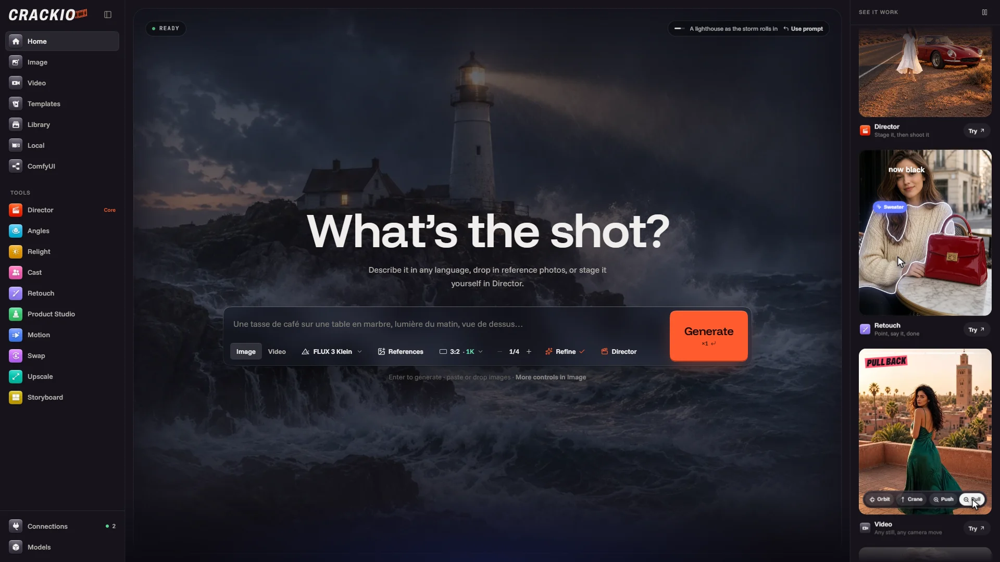

Crackio is a full AI studio for pictures and video: stage a shot on a 3D set, cut a film together, swap anyone or anything in a clip, shoot product ads, relight, re-angle, retouch and upscale. Everything runs on open models through ComfyUI, on your own computer, and every result keeps the exact ComfyUI workflow that made it.

## Why Crackio

- **Runs on what you have.** A 2016 GTX 1060 with 6 GB, any RTX card, a MacBook, two computers sharing one model, a GPU you rent by the second, or Comfy's cloud. Crackio reads your machine, installs what fits, and tells you how long each job will take *before* you press Generate.
- **A whole studio, not one trick.** 16 tools, from a 3D Director and a Storyboard editor to swaps, templates and product ads, in one app.
- **ComfyUI inside.** Every job is a ComfyUI graph. Watch it run live, open any result's workflow in ComfyUI, or download it. Crackio ships its own ComfyUI nodes too.
- **Free, private, yours.** No account and no subscription. Your files stay on your machine, and the code is MIT.

## Get started

| You need | |
| --- | --- |
| **A computer** | Windows 10 or 11, or macOS 13+ on Apple silicon. Linux works from the terminal |
| **Node.js 22.13+** | the LTS installer from [nodejs.org](https://nodejs.org/en/download) |
| **Disk** | about 5 GB for Crackio and ComfyUI, plus 0.1 to 40 GB per model (shown before you install) |
| **A GPU (optional)** | NVIDIA GTX 10 or newer, Apple silicon, AMD or Intel Arc. No GPU? Use RunPod Serverless, a rented GPU or Comfy's cloud |

### Windows

1. Install Node.js from [nodejs.org/en/download](https://nodejs.org/en/download).
2. Get Crackio: on GitHub click **Code → Download ZIP**, then right-click the ZIP and choose **Extract All** (or `git clone` it).
3. Double-click **Start Crackio.bat**. The first time it installs and builds Crackio, which takes about 5 minutes; then your browser opens Crackio by itself.

Keep the black window open while you use Crackio: closing it stops Crackio. Next time it starts in seconds.

### macOS

1. Install Node.js from [nodejs.org/en/download](https://nodejs.org/en/download).
2. Get Crackio: **Code → Download ZIP** and double-click the ZIP to unzip it (or `git clone` it).
3. The first time, **right-click Start Crackio.command → Open → Open**. macOS asks once because the file comes from the internet; after that a double-click is enough. The first run installs and builds Crackio (about 5 minutes); then your browser opens Crackio by itself.

Keep the Terminal window open while you use Crackio: closing it stops Crackio.

### From a terminal (any system)

```bash
git clone https://github.com/RafalOfficial/Crackio.git
cd Crackio
corepack enable pnpm
pnpm install
pnpm studio          # builds, then runs on http://localhost:3211
```

### Your first picture

1. In Crackio, open **Local** and press **Install ComfyUI**. It goes into one folder of its own with the PyTorch build your GPU needs, and nothing else on your system changes.
2. Install a model Local recommends for your machine (FLUX 3 Klein on most cards, FLUX.2 klein 4B on 6 GB cards and Macs).
3. Open **Image**, type what you want, press **Generate**. Everything you make stays in `data/` on your computer.

No GPU? Add a RunPod or vast.ai key under **Connections** (or a RunPod Serverless endpoint), or a Comfy key for Comfy's cloud models.

<details>
<summary><b>Troubleshooting</b></summary>

- **The Node.js download page opens instead:** Node.js is missing or older than 22.13. Install the current LTS, then start Crackio again.
- **"Installing didn't work":** check your internet connection and start it again; it picks up where it stopped.
- **macOS says the file can't be opened, or "permission denied":** right-click it and choose Open. If that doesn't help, open Terminal in the Crackio folder and run `chmod +x "Start Crackio.command"` once.
- **Something else already uses port 3211:** close the other Crackio window, or start it on another port: `set CRACKIO_PORT=3300` before running the `.bat` from a Command Prompt, or `CRACKIO_PORT=3300 "./Start Crackio.command"` in Terminal.
- **Updating:** download the new version (or `git pull`) and start it the same way; it rebuilds only when the code changed.
- **Models:** pictures and video run on your own GPU through ComfyUI, which Crackio installs for you from the **Local** page, or through Comfy's cloud with a Comfy API key (**Connections**).

</details>

## Tools

<table>
<tr><td width="50%" valign="top">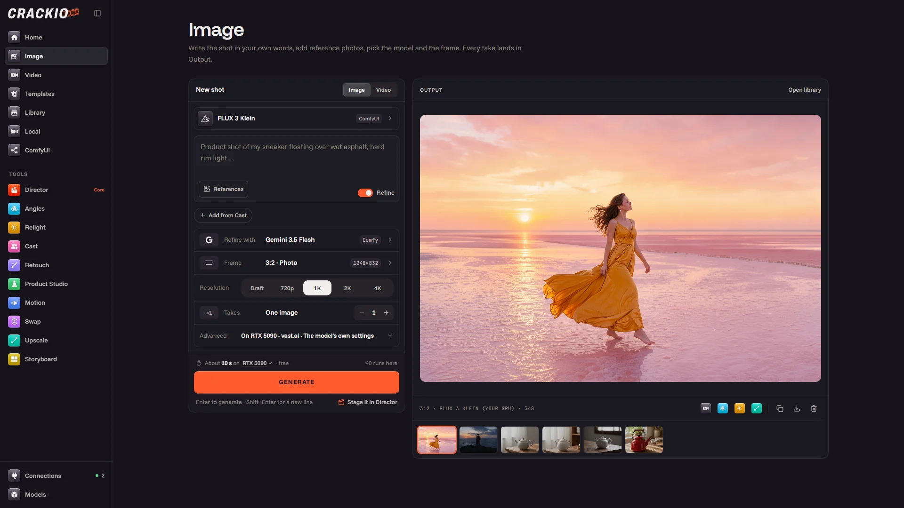<br><b>Image</b><br>Type what you want in any language, add reference pictures or @ someone from your Cast, and press Generate. Runs on open models on your GPU (FLUX 3 Klein, Z-Image Turbo, Qwen-Image 2.1, FLUX.2 klein 4B and more), or with a Comfy key on Comfy Router (FLUX 3, Nano Banana 2.1, Seedream 5.0 Pro, Qwen-Image 3.0, GPT Image 2.5). Draft to 4K, with negative prompt, steps, guidance and seed under Advanced.</td><td width="50%" valign="top">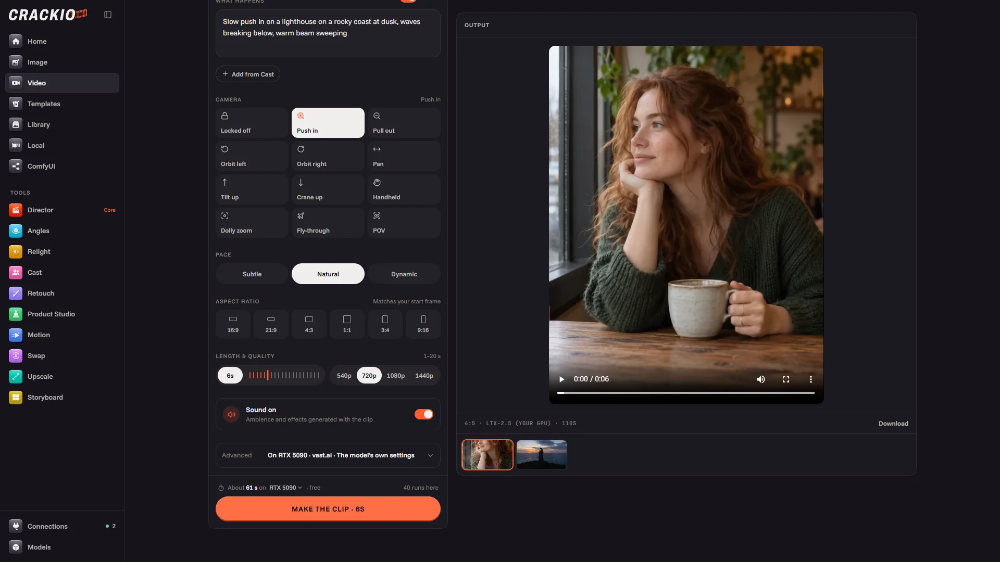<br><b>Video</b><br>A clip from words, or from a start and end frame: pick the camera move (push in, orbit, crane, pan and more), the pace, the shape, the length and sound. Runs on LTX-2.5 on your GPU (with sound, up to 1080p) or Wan 2.2 5B on small cards; with a Comfy key, Kling 3, Veo 3.1, Seedance 2.5, MiniMax H3 and Wan 3.0 too.</td></tr>
<tr><td width="50%" valign="top">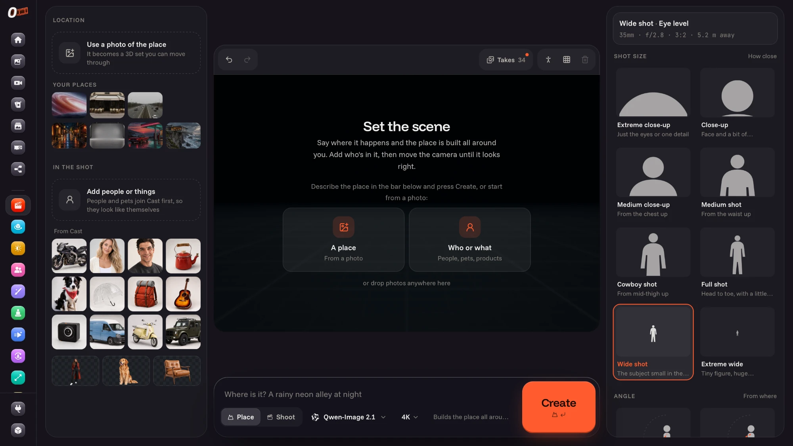<br><b>Director</b><br>A sentence or a photo becomes a 3D set. Put your cast on their marks, aim the camera, shoot. <a href="#director">More below</a>.</td><td width="50%" valign="top">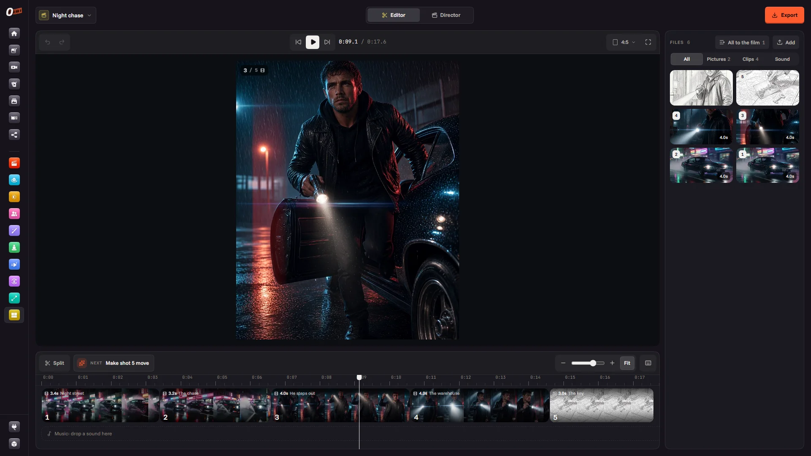<br><b>Storyboard</b><br>Shoot your scenes, cut them on a timeline, make stills move with LTX-2.5, export one film. <a href="#storyboard">More below</a>.</td></tr>
<tr><td width="50%" valign="top">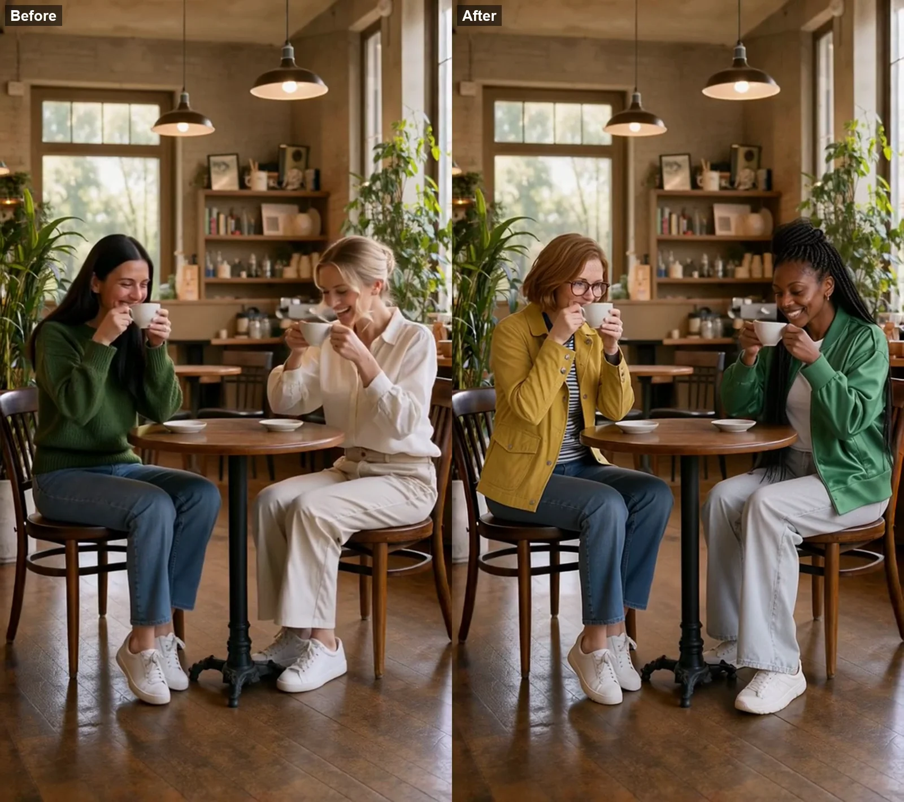<br><b>Swap</b><br>Click anything in a clip and pick what it becomes: someone from your Cast, a product, a colour, or gone. <a href="#swap-and-templates">More below</a>.</td><td width="50%" valign="top">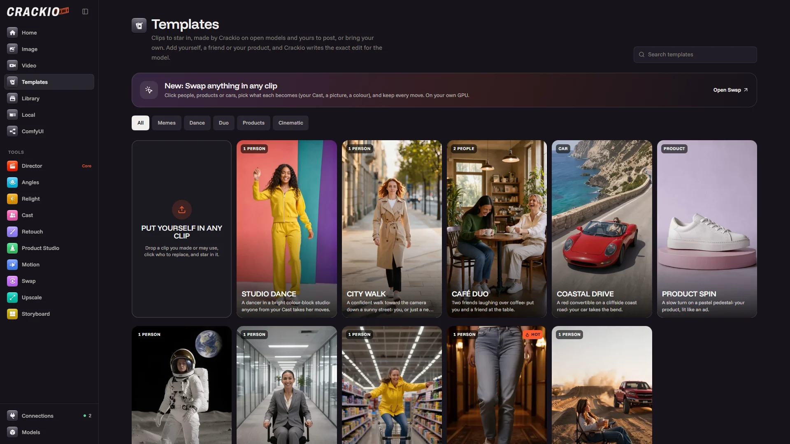<br><b>Templates</b><br>11 ready-made clips made by Crackio on open models. Put yourself, a friend or a product in them.</td></tr>
<tr><td width="50%" valign="top">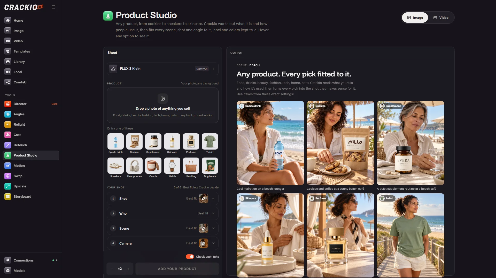<br><b>Product Studio</b><br>Drop a photo of anything you sell. Crackio reads what it is and how people use it, suggests the shot, who's in it, the scene and the camera, then checks every take against your product and re-shoots any where the label or shape drifted. Video mode makes short product films.</td><td width="50%" valign="top">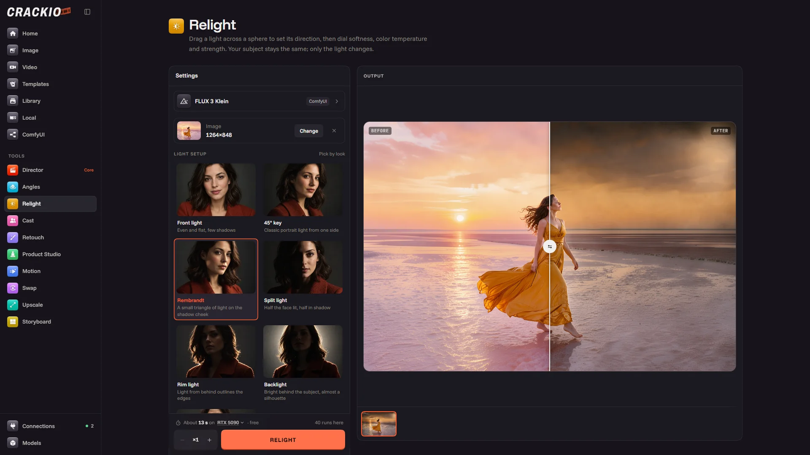<br><b>Relight</b><br>Drag a light around a sphere, or pick a look (front, 45° key, Rembrandt, split, rim, backlight, coloured gels). Your subject stays exactly as it is; only the light changes.</td></tr>
<tr><td width="50%" valign="top">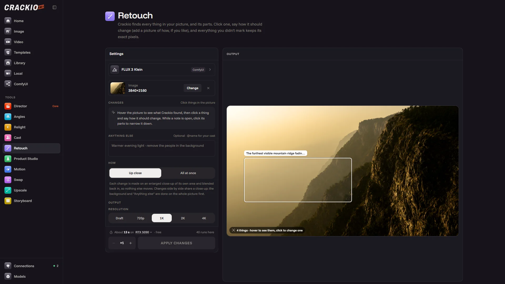<br><b>Retouch</b><br>Crackio finds every thing in your picture and its parts. Click one, say how it should change (or add a picture of how), and it's redrawn on an enlarged close-up and blended back: everything you didn't mark keeps its exact pixels.</td><td width="50%" valign="top">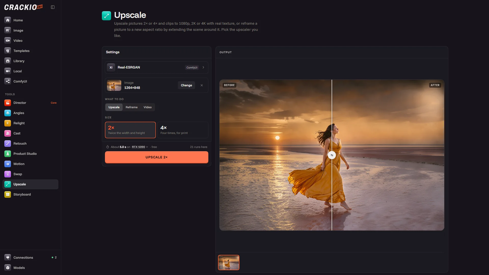<br><b>Upscale</b><br>Pictures 2× or 4× (Nomos2 HQ, Real-ESRGAN, SeedVR2) and clips to 1080p, 2K or 4K (FlashVSR+, SeedVR2), on your GPU, with a before/after slider. Reframe extends the scene to a new shape.</td></tr>
<tr><td width="50%" valign="top">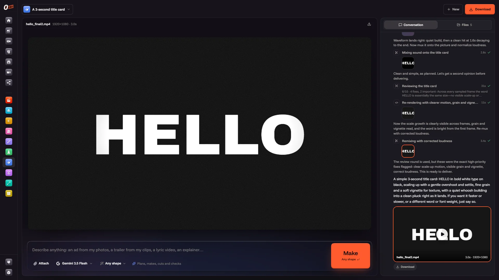<br><b>Motion</b><br>An agent that makes ads, trailers, lyric videos and explainers: it plans the piece, builds it in code (type, graphics, 3D, camera moves, sound), makes pictures and clips on your GPU or Comfy key only where they're needed, cuts with ffmpeg and checks its own work. It thinks on Comfy Router's chat models (Claude Sonnet 5 works best), so it needs a Comfy key.</td><td width="50%" valign="top">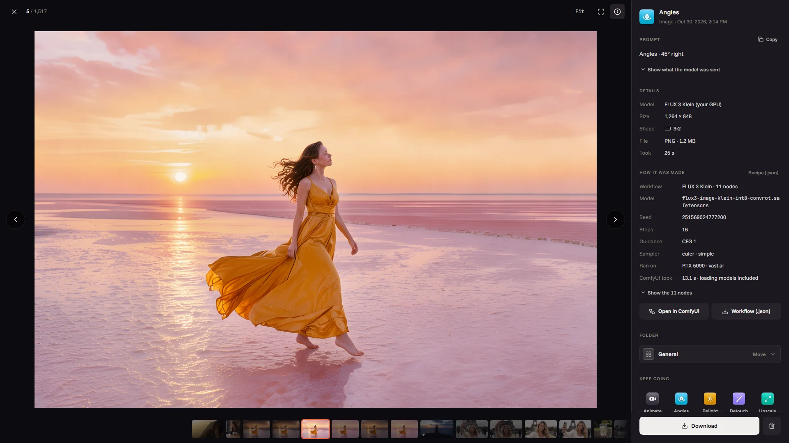<br><b>Library</b><br>Everything you made, in folders, stored on your computer. Open any take to zoom, play or download it; **How it was made** shows the model, settings and seed, the machine and GPU it ran on, how long it took, and the ComfyUI workflow itself, ready to open in ComfyUI or download.</td></tr>
<tr><td width="50%" valign="top">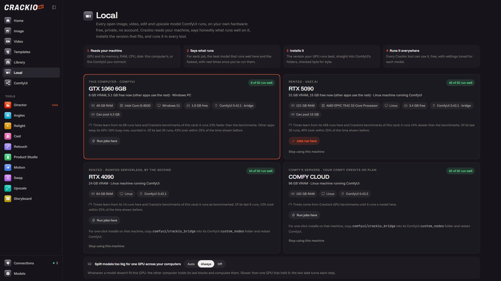<br><b>Local</b><br>Reads each machine's GPU, memory and disk (this computer, another one on your network, a rented vast.ai or RunPod GPU, RunPod Serverless, Comfy Cloud), says which open models run well on it with real times, and installs ComfyUI and models in one click. Two computers can split one model neither could hold alone.</td><td width="50%" valign="top">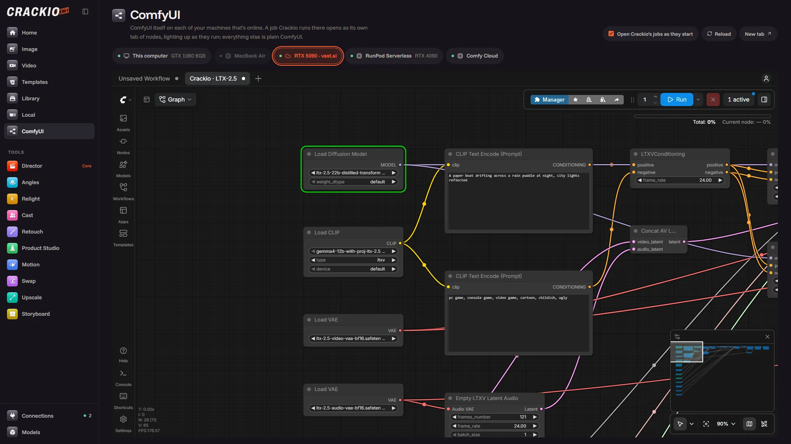<br><b>ComfyUI</b><br>Every ComfyUI you've connected opens inside Crackio as ComfyUI itself. Each job Crackio runs appears in its own tab of nodes, and the running node lights up.</td></tr>
<tr><td width="50%" valign="top">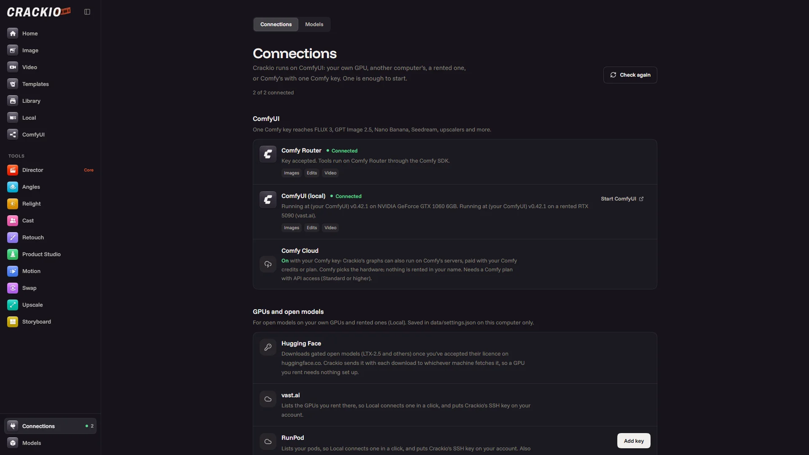<br><b>Connections</b><br>One Comfy key reaches Comfy Router's hosted models and Comfy Cloud. Add your ComfyUIs, a Hugging Face token for gated open models, vast.ai and RunPod keys for rented GPUs, and RunPod Serverless endpoints. Keys stay on your computer.</td></tr>
</table>

## Director

Stage a shot like a film set, then shoot it with open models on your own GPU.


- **A sentence or a photo becomes a 3D place.** Type "a sunlit Parisian café terrace, morning" (or drop a photo) and the place is built all around you. Walk through it with WASD (Q/E up and down, arrows to look), and **Extend** grows it wherever the camera looks.
- **Your cast and your products on their marks.** Add people, pets and things from **Cast** or straight from a photo (cut out on your machine), then move and turn each one on the set. **Arrange** places everyone from one sentence ("Kai rides the motorbike toward the camera, Noor waves"): sitting, riding, waving, pointing, a selfie with the arm held out.
- **Real camera choices.** Shot size from extreme close-up to extreme wide, angles from worm's-eye to high, lens and aperture, and **Scout** to look around the set before you shoot.
- **Shots drawn through a depth ControlNet**, so the picture keeps your camera and everyone's marks and looks like a film still, not a collage. Two open models:
  - **Z-Image Director** (Z-Image Turbo + Alibaba PAI's Fun ControlNet Union, Apache-2.0): the most cinematic. Measured: about 4 s a shot on an RTX 5090, 6.5 min on a GTX 1060 6 GB, 12 min on a MacBook Air M2 16 GB.
  - **Qwen Director** (Qwen-Image 2.1 + its Fun ControlNet, Qwen Research License, non-commercial): also takes your cast's and products' pictures, so faces and clothes stay theirs. About 14 s on an RTX 5090 (NVIDIA RTX 20 or newer, ~17 GB).
- **Takes keep their plan.** Every shot is filed with the set it was shot from, so you can compare, tweak and shoot again.
- **LoRAs** from the library switch on for the shot model in one click.
- Runs through ComfyUI on your own GPU, a second computer on your network, or a cloud GPU (RunPod serverless).

Your stage → the shot (Qwen Director, generated cast):


### How to use it

1. Open **Director** and say where it happens (or drop a photo), then press **Create**: the place is built around you.
2. Add who and what is in the shot, from **Cast**, a photo, or a product, and drag them onto their marks, or type one sentence into **Arrange**.
3. Frame it: pick a shot size and an angle on the right, walk in with WASD, or **Scout** the set.
4. Write what happens ("Lena waits outside the café with a coffee in her hand") and press **Shoot it**. Pick **Z-Image Director** for the most cinematic look or **Qwen Director** to keep faces exact.
5. Open **Takes** to compare each shot with your stage, then **Extend** the place, move the camera or shoot again.

## Storyboard

Make a whole film, not one clip at a time: shoot your scenes in the Director, cut them together on a timeline, make each picture move, and export one MP4.


- **Every film is a project.** A project is a folder in your Library. Every shot and clip made inside it is filed there automatically, and the project keeps its timeline and its Director set (the place, the cast, the camera), so you can come back to it exactly as you left it.
- **The Director is built in.** Switch between **Editor** and **Director** at the top. In the Director you shoot from any angle in the same place with the same people, and each shot lands in the project's **Files**.
- **A simple timeline.** Shots follow each other with no gaps. Drag a shot to reorder it, drag its edges to trim it, press **S** to split. A music track sits under the shots. The bar above the timeline holds the selected shot's settings: length and push-in for stills; trim, speed and volume for clips; fill or fit and fades for both.
- **All to the film.** One click puts every shot from Files on the timeline in the order you made them. A **Next** button always shows the next step (shoot, cut, make shot 3 move, export) and does it.
- **Make it move.** Click a still and pick a camera move from 12 presets with preview clips (push in, orbit, crane up, dolly zoom, fly-through, POV…), a pace (slow, normal, dynamic) and a length. LTX-2.5 runs on your GPU or a cloud GPU, and the clip takes the still's place on the timeline. Your words can be refined by your own prompt writer, and you can @mention your Cast.
- **Export one MP4.** 720p or 1080p, in the film's shape (16:9, 9:16, 1:1, 4:5 or 21:9), with each clip's sound and your music mixed in. Everything is saved as you go.

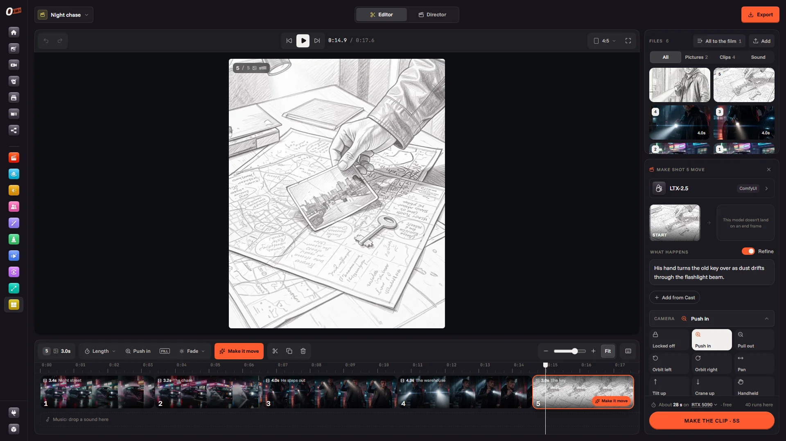

### How to use it

1. Open **Storyboard**. Your film is a project: make a new one from the menu at the top left.
2. Switch to **Director**, build the place and add your cast, then shoot your scenes. Every shot lands in **Files**.
3. Back in **Editor**, press **All to the film** (or drag shots onto the timeline), then reorder and trim them until the story reads right.
4. Click a still, choose **Make it move**, pick a camera move and a pace, and press **Make the clip**. The clip takes the still's place when it's done.
5. Drop a sound on the music track if you like, then **Export** to get one MP4.

## Swap and Templates

### Swap

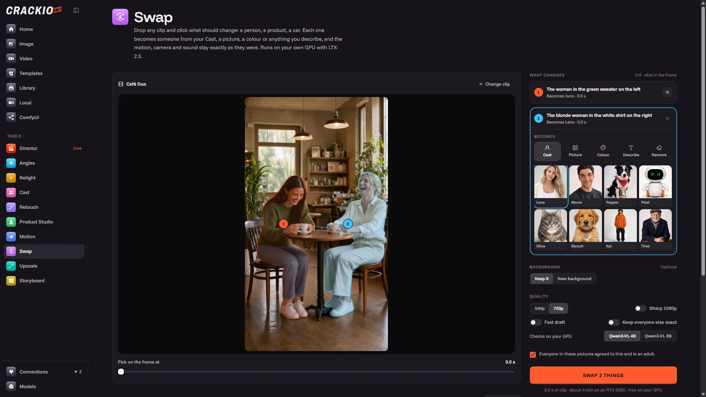

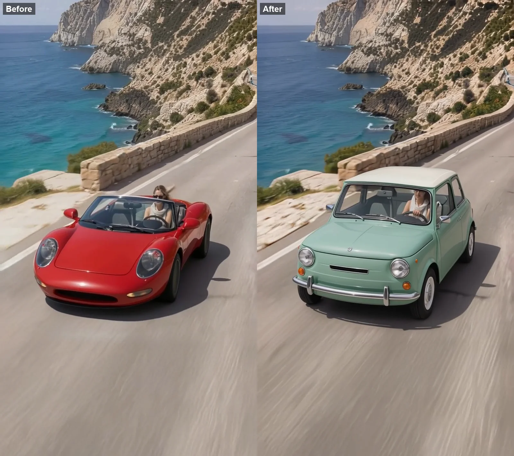

- **Click anything, pick what it becomes.** Drop a clip, click up to four things in it (people, products, cars) and turn each into someone from your Cast, a picture you add, a colour, anything you describe, or nothing at all (removed). A new background is optional, and the clip's own sound stays.
- **How it works, on your GPU:** SAM 3.1 follows what you clicked through the whole clip. FLUX 3 Klein redraws the frame where it shows best, with the pose read out in words first, and a vision model keeps the better of two takes (right character, whole outfit, same pose). Then **LTX-2.5** (22B, distilled) with WepeNerd's **Ripple** IC-LoRA carries that drawing through every frame, one pass each way for clips up to 20 s.
- **Long clips stay on model:** on clips over about 4 s the character is redrawn again every ~4 s on a calm frame, matched to the first drawing, and LTX gets those drawings as keyframes of the same pass, so nothing is blended or cut in. A keyframe that changed the wrong person, or the wrong pose, is thrown away.
- **Removals leave a clean plate:** removing something uses Lightricks' in/outpainting IC-LoRA on its tracked outline in every frame; the rest of the clip stays exactly as filmed.
- **Every drawing is checked** by Gemini 3.5 Flash (with a Comfy API key) or by Qwen3-VL 4B or 8B on your own GPU (4B is FLUX 3 Klein's own text encoder). One of the two is needed; you pick 4B or 8B on the Swap page.
- **Speed:** on an RTX 5090, a 6–8 s clip at 720p takes about 5 minutes from click to result; 15 s with two people about 13 minutes. It needs a GPU with about 24 GB (your own or a rented one). On small cards Crackio swaps characters with **SCAIL-2** instead: a 6 GB GTX 1060 makes 5 s in about 46 minutes.

**How to:** open **Tools → Swap** and drop a clip (or pick a preset) → click what to change and pick what each becomes → choose 540p or 720p (Sharp 1080p and Fast draft are optional) → **Swap**. The result plays next to the original.

### Templates

- **11 templates, all Crackio's own:** clips made on open models (FLUX 3 Klein stills, LTX-2.5 clips) with nobody's footage, likeness, music or brand in them, plus **Put Yourself in Any Clip** for a clip of your own.
- **You star in them:** add a photo or a Cast member for each role and Crackio writes the exact edit; each card plays a swap Crackio made on it.
- **Two-person templates:** click who becomes whom on the template's frame; each person is outlined in their own colour and followed and redrawn on their own.
- **Same engine as Swap:** templates run the Ripple swap on your own ComfyUI by default; with a Comfy key, Comfy Router's swap models are one click away.

**How to:** open **Templates** → pick a clip → add a photo or a Cast member for each role → click who becomes who (on two-person templates) → **Make it**.

## Runs wherever you like

Measured through Crackio on real machines (Oct 2026):

| Where | What to expect |
| --- | --- |
| **GTX 1060 6 GB** (2016) | a picture in about 1 min, an edit in 2.5 min, a 5 s 540p clip in about 9 min, a Director shot in about 6.5 min |
| **MacBook Air M2 16 GB** | a picture in about 1.6 min. Crackio tunes ComfyUI for Apple's GPU and looks after heat and battery |
| **RTX 4060 Ti / 4070** | a picture in 3 to 11 s, a 5 s 720p clip in about a minute |
| **RTX 5090** | a 4K picture in 33 s, a 5 s 720p LTX-2.5 clip with sound in about 55 s, a Director shot in about 4 s |
| **Two computers** | one model split across both GPUs, for models neither can hold alone |
| **No GPU** | a GPU on RunPod Serverless, billed by the second; a rented vast.ai or RunPod box; or Comfy's cloud models with a Comfy key |

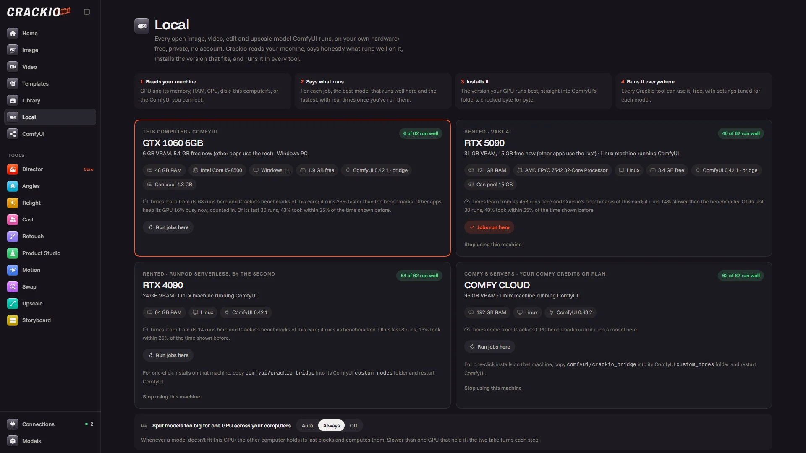

- **Local** reads every machine you connect, recommends the models that fit, installs them in one click (GGUF on small cards and Macs) and learns each job's real time.
- **Connections** takes your own keys: a Comfy key (Comfy Router models and Comfy Cloud), a RunPod key (pods and **RunPod Serverless** endpoints) and a vast.ai key. GPUs you rent there connect by themselves.
- **Run on** picks the machine per job, or leave it on Auto: the free machine with the fastest GPU that has the model.

## Built on ComfyUI

- **Every job is a ComfyUI workflow.** Open models run on your ComfyUI, on other computers on your network, on a rented box or on RunPod Serverless. Cloud models go through Comfy Router with the official Comfy SDK ([`@comfyorg/sdk`](https://docs.comfy.org/development/api-development/sdks)). Text and vision run through ComfyUI too: an open language model on your GPU with the core Generate Text node, or a hosted one through Comfy Router.
- **Crackio's own nodes**, in [`comfyui/crackio_bridge`](comfyui/crackio_bridge) (MIT), installed with ComfyUI and usable in any workflow:
  - **Pool Loader (GGUF):** one model split across two computers' GPUs. Only the activations travel, 15 to 60 MB a step.
  - **Lanes Sampler:** two pictures side by side, so both computers work all the time (6.1 min split against 8.3 min on one PC).
  - **Window Attention:** character swaps on 6 GB cards (a step of a 5 s swap takes 12 min instead of 19 on a GTX 1060).
  - **FP16 On Old GPUs** and **Resample Frames**, plus Mac tuning and live GPU state for the time estimates.
- **The ComfyUI page.** Every ComfyUI you've connected opens inside Crackio as ComfyUI itself, and a running job lights up node by node.
- **Every result keeps its workflow.** The Library's **How it was made** shows the model, settings, seed, machine, GPU and time, and opens the graph in ComfyUI or downloads it.
- **[`workflows/`](workflows):** 15 graphs captured from 11 real Crackio jobs, each runnable in stock ComfyUI.


## Models and tools used

- **Open models, installed from the Local page** (each shows its licence there):
  - **Pictures and edits:** FLUX 3 Klein, FLUX.2 klein 4B (for 6 GB cards and Macs), Qwen-Image 2.1, Qwen-Image-Edit 2511, Z-Image Turbo, plus about 50 more.
  - **Director shots:** Z-Image Director (Z-Image Turbo + Fun ControlNet Union 2.1) and Qwen Director (Qwen-Image 2.1 + its Fun ControlNet Union; Qwen Research licence, non-commercial).
  - **Clips:** LTX-2.5 with WepeNerd's Ripple IC-LoRA and the in/outpainting IC-LoRA, Wan 2.2 5B (small cards), and SCAIL-2 (character swaps).
  - **Tracking:** SAM 3.1. **Upscaling:** SeedVR2, FlashVSR+, Nomos2 and Real-ESRGAN. **In-between frames:** FILM.
  - **Text and vision on your GPU:** Qwen 3.5 9B, Qwen3-VL 8B and 4B, through Generate Text.
- **Optional, on your own Comfy key:** Comfy Router's hosted models (FLUX 3, GPT Image 2.5, Kling, Veo, Seedance, Wan, MiniMax H3, Grok Imagine, and hosted text models) and Comfy Cloud.
- **Inside the app:** Depth Anything V2 and BiRefNet (onnxruntime) for sets and cut-outs, ffmpeg for clips, yt-dlp as Motion's download tool for clips you have the rights to. Built with Next.js 16, React 19, React Three Fiber (three.js), Tailwind 4 and GSAP.
- **Crackio's own page art:** the pictures and showcase clips on Crackio's pages were made with Grok Imagine 1.5 and GPT Image 2 ([`scripts/assets`](scripts/assets)). The templates' clips are all open models: FLUX 3 Klein and LTX-2.5.

## Deep dives

<details>
<summary><b>Run models on your own GPU: install, times, Macs, upscalers</b></summary>

Open **Local** in the sidebar. Crackio reads your machine (GPU and its free memory, RAM, disk), says honestly what runs well on it, installs the version that fits, and runs it in every tool: free, private, no account.

1. **Install ComfyUI** once, from the Local page. It gets one folder of its own: Python, ComfyUI, the PyTorch build your GPU needs and Crackio's bridge node. Nothing else on your system changes, and deleting the folder removes all of it. From then on it starts with Crackio (stop it on the Local page and it stays stopped).
   - NVIDIA: GTX 900 series and newer. RTX 20 series and newer get CUDA 13 with driver 580+, everything else CUDA 12.6.
   - AMD: ROCm on Linux; on Windows 11, AMD's ROCm build for RX 6000 and newer.
   - Intel Arc (XPU) and Apple Silicon (Metal).
2. **Pick a model.** Every open model ComfyUI runs is listed with what it needs and how long it should take on this machine (see **How long a job takes** below). Install fetches the version that fits (GGUF on small cards and Macs) and checks it byte for byte.
3. **Use it.** Installed models are in every tool's model picker as "(your GPU)", and the time a job will take on your machine shows above the Generate button.

Measured through Crackio on real machines (Oct 2026): seconds per job with the model loaded, ComfyUI's own time (a rented box adds a few seconds of network). † the first run, loading included. ‡ PyTorch's CUDA 12 build, which leaves ComfyUI's INT8 kernels off: about 3× slower (Crackio now puts in CUDA 13 where the driver runs it). The time Crackio shows for any other card scales from these, and from the model's first run on yours.

| GPU | FLUX.2 klein 4B picture | FLUX.2 klein 4B edit | FLUX 3 Klein picture | Z-Image Turbo picture | Qwen-Image 2.1 picture | Wan 2.2 5B, 5 s 720p | Real-ESRGAN, 640×424 ×2 | Nomos2 HQ, 640×424 ×2 | SeedVR2 7B, 640×424 ×2 |
|---|---|---|---|---|---|---|---|---|---|
| RTX 5090 |  |  |  |  | 7.5 s INT8 |  | 0.9 s | 3.5 s | 1.8 s INT8 |
| RTX 5070 Ti | 2.4 s BF16 | 4.6 s BF16 | 12.6 s INT8‡ | 9.5 s INT8‡ |  | 24.1 s FP16 | 1.4 s | 3.5 s | 2.2 s INT8‡ |
| RTX 4070 | 3.2 s BF16 | 7.6 s BF16 | 4.8 s INT8 | 15 s† INT8 | 13.9 s Q6 | 60.6 s† Q8 | 2.4 s† | 4.9 s† | 6.8 s† INT8 |
| RTX 5060 Ti |  |  |  |  |  |  | 3 s† | 13.2 s† |  |
| RTX 4060 Ti | 10.7 s† BF16 | 9.8 s BF16 | 10.5 s† INT8 | 11.5 s† INT8 | 24.7 s† Q8 | 48 s† FP16 | 2.2 s | 7 s† |  |
| RTX 2080 Ti | 23.7 s† BF16 | 11.7 s BF16 |  | 22.6 s† INT8 |  | 84.8 s† Q6 | 2.4 s† | 8.1 s† |  |
| RTX 3060 Ti | 5.2 s FP8 | 11.7 s FP8 | 8 s INT8 |  |  |  | 2.2 s | 7 s | 2.2 s INT8 |
| GTX 1080 Ti |  |  |  | 132 s† Q5 |  |  | 3.5 s† | 31.9 s† |  |
| GTX 1060 6 GB | 67.5 s Q5 | 150 s Q5 |  |  | 224 s† Q8 | 536 s Q4 540p |  |  |  |

A MacBook Air M2 16 GB: a FLUX.2 klein 4B picture in ~1.6 min (97 s; 2.4 min before the Mac tuning below), an upscale 2× in ~21 s. An RTX 5090: a 5 s 720p LTX-2.5 clip with sound in ~55 s.

**On a Mac**, Crackio tunes ComfyUI for Apple's GPU (measured on a MacBook Air M2 16 GB with PyTorch 2.14, Oct 2026):

- **The fastest number format.** M1 and M2 GPUs have no bf16 math, so ComfyUI's default runs at half speed there. Crackio's bridge times fp16, bf16 and fp32 on your chip and computes each model in the fastest one it's made for: FLUX.2 klein went from 28 to 17 s a step, the same picture.
- **Apple's attention kernel.** PyTorch's fused Metal attention instead of ComfyUI's Mac default: twice as fast, without the 4–5 GB of scratch memory per attention that pushed a 16 GB Mac into swap. ComfyUI's default also turns LTX clips black on Macs.
- **Mac-safe samplers.** uni_pc becomes euler: on Apple GPUs it blows out Wan clips.
- **Memory back.** On Macs with 24 GB or less, ComfyUI lets its models go after 5 idle minutes, so your other apps get the memory back.
- **Heat and battery.** A job keeps the GPU at full power for minutes, and a MacBook Air has no fan. Crackio reads macOS's thermal state and the battery's temperature. When the Mac is hot, it waits between steps until it cools. On a MacBook Air, work that runs past 3 minutes rests between steps while the Mac is warm. Unplugged at 10% battery, it stops rather than drain it. Expect an Air to get warm: plug it in for clips and keep it on a hard surface.

**How long a job takes.** The time above the Generate button, and every model's time on the Local page, is Crackio's best estimate for that job on the machine it will run on, with a likely range and where it comes from (`src/lib/local/estimate.ts`):

- **The card and its series.** Crackio reads the GPU ComfyUI runs on and its series: the first two digits of a GeForce card's number (RTX 4070 → RTX 40, GTX 1080 → GTX 10), or its architecture for workstation, Apple, AMD and Intel GPUs.
- **Benchmarks first.** The starting point is the runs measured on real cards, shipped in `src/lib/local/benchmarks.ts`. Next to Crackio's own runs on 9 cards are 232 published timings of 25 more models on over 50 cards (`scripts/local/reported-times.json`). Each published timing keeps its source, is converted to the job Crackio's template runs (steps, size, frames), and counts for less than Crackio's own runs. The estimate uses the same card's numbers if there are any, else its series', else every card's. Each is carried over by the cards' speed, the model's precision (INT8 on PyTorch's CUDA 12 build, FP8 on cards without FP8 math) and, on GTX 10 cards, what that model loses without tensor cores. A model with no timings at all starts from its size and steps, or from the model it's built on.
- **The machine now.** Crackio's bridge in ComfyUI reports the GPU's state. Memory other apps hold leaves less for the model. What doesn't fit streams from RAM every step, timed by the GPU's PCIe link; Windows lends the GPU system memory instead, which is far slower. Other apps keeping the GPU busy count too, and so does loading the model when the last job ran another one, at the speed this machine's disk showed.
- **Every run teaches it.** Each job's real time is kept, with what was estimated before it. After a run or two of a model its own runs take over, and after one when they disagree with the benchmarks (a GTX 1060's Nomos2 HQ estimate went from 250 s to 75 s after its first 64 s run); the recent ones and those of a similar size count most. How the machine compares with its benchmarks across every model it ran (a laptop's power limit, a slower bus, a busier desktop) carries over to the models it hasn't run yet. The Local page shows, per machine, how many runs it learned from and how many of its recent runs took within 25% of the time shown before.

Each Local card times one job: a ~1 MP picture, an edit with one reference picture, 5 s of 720p clip, or a 1 MP picture upscaled 2×. Its quality score is the model's standing among open models for its task: from public arenas (Artificial Analysis's open-model boards, Oct 2026) and, for upscalers, Crackio's own tests.

Disk: Crackio takes about 2.5 GB with its packages and ComfyUI about 2 GB; each model 0.1–40 GB, shown before you install. Got a second computer? On its Local page tick **Let my other computers use it**, then add its address under **Use another computer** here: each job runs on a machine that has its model (experimental).

**Pick the machine.** With more than one machine connected (this computer, another one, a rented GPU), jobs go to **Auto**: the free machine with the fastest GPU that has the model. To choose one, click the GPU's name in the time above Generate, open **Advanced → Run on**, or press **Run jobs here** on that machine's card on the Local page. Each lists every machine with the job's time there, or why it can't take it (offline, without the model, jobs ahead). The choice holds for every tool until you set Auto again; when that machine is offline or lacks the model, the job runs on Auto's pick and the time line says so.

**Resolution and Advanced.**
- **Resolution:** pictures from open models come at Draft, 720p, 1K, 2K or 4K. Each model renders natively up to the size it handles well; past that, Real-ESRGAN enlarges the picture, and Crackio installs it itself the first time it's needed.
- **Advanced:** sets the negative prompt, steps, guidance and seed. It offers only what the model's own workflow uses, with the model's values as defaults.
- **Measured on a rented RTX 5090:** a 4K Qwen-Image 2.1 picture took 33 s, and a 1080p LTX-2.5 clip took 118 s.

**Upscale on your own GPU.** The Upscale tool enlarges pictures 2× or 4× and clips to 1080p, 2K or 4K through ComfyUI, with any of these (the Local page installs them):

| Upscaler | Pictures | Clips | Licence | What it's like |
| --- | --- | --- | --- | --- |
| **SeedVR2 7B** | ✅ | ✅ | Apache-2.0 | One-step diffusion restoration: the closest to real footage, and the one for soft, old or compressed photos |
| **FlashVSR+** (Turbo) | | ✅ | Apache-2.0 | Built for clips at 4×: next closest on real footage, in about half SeedVR2 7B's time (NVIDIA RTX 30 or newer; Crackio sets up its custom node, pinned) |
| **Nomos2 HQ** | ✅ | | CC-BY-4.0 (Phips) | The best for AI renders: by far the closest to the original, crisp edges and text, nothing invented |
| **Nomos WebPhoto** | ✅ | | CC-BY-4.0 (Phips) | Real photos: cleans JPEG and web compression while it sharpens |
| **Real-ESRGAN** | ✅ | ✅ | BSD-3-Clause | Fastest, on any machine: invents nothing, the steadiest from frame to frame |
| **SeedVR2 3B** | ✅ | ✅ | Apache-2.0 | SeedVR2 for 12–16 GB cards: less faithful than 7B, and for clips not faster |

How they compare, measured on the rented RTX 5090 (Oct 2026): each original was shrunk, upscaled back and compared with itself, frame by frame (LPIPS: how different it looks, lower is closer; times are ComfyUI's own on the box).

| | Live-action clip, 5 s, 864×360 → 1920×800 | Crackio's LTX clip, 5 s, 832×488 → 1842×1080 | Three Qwen-Image pictures, 2× from 640×424 |
| --- | --- | --- | --- |
| SeedVR2 7B | **0.106**, 166 s | 0.118, 223 s | 0.093 |
| FlashVSR+ Turbo | 0.121, 105 s | 0.161 | |
| Nomos2 HQ | | | **0.022**, ~5 s |
| Nomos WebPhoto | | | 0.055 |
| Real-ESRGAN | 0.131, 73 s | **0.109**, 73 s | 0.099 |
| SeedVR2 3B | 0.172 | 0.190 | 0.130 |
| Plain bicubic resize | 0.097 | 0.062 | 0.084 |

A plain resize stays closest on clean, mildly shrunk material: the upscalers add sharpness the original didn't have. Where they earn their keep is soft, compressed or very small sources, and there SeedVR2 7B brings back the most.

**ComfyUI page.** Every ComfyUI that's online (this computer's, others on your network, rented GPUs) opens inside Crackio as ComfyUI itself. A small relay adds a rented box's token. A job Crackio runs opens in its own tab of nodes, the running node lights up, and the result lands in its save node.

</details>

<details>
<summary><b>No GPU: rented GPUs and RunPod Serverless</b></summary>

Rent a GPU with your cloud's ComfyUI template (vast.ai, RunPod, or any box with ComfyUI and SSH), then paste its SSH command, or its ComfyUI link, into **Local → Connect a rented GPU**. Crackio logs in and reads the box's address and token. It then copies its bridge into ComfyUI and restarts it, so the box joins your machines. From then on, models install there from the Local page and every tool's jobs can run there.

- **One-time setup:** your SSH key on the cloud account. Crackio uses the one in `~/.ssh`, or makes one; **Add to vast.ai** puts it there for you. Your Hugging Face token goes under **Connections → GPUs and open models**. Crackio sends it with each download, so a box you rent needs no setup of its own.
- **With your vast.ai or RunPod key in Connections**, no pasting: a GPU you rent there shows up on the Local page within half a minute and connects by itself. Its first step waits while the cloud places the box and pulls its image (shown in the cloud's own words, "loading · Pull complete"), until the cloud says it runs and its SSH answers; on vast.ai Crackio then puts its SSH key on the box through the API (a RunPod pod needs the key on the account before it starts). A box you give back leaves your machines, and one restarted at new ports connects again. Turn **Connect GPUs I rent by themselves** off to press Connect on each instead.
- **Measured on 2026-10-24** with a vast.ai RTX 5090 (Malaysia, $0.54/h), on the official ComfyUI template:
  - Running 3 minutes after renting.
  - Connected 91 seconds after pasting its SSH command, 70 of them waiting for the template's first boot; a box that's already set up reconnects in 6 seconds.
  - 57 GB of models downloaded at about 120 MB/s.
  - A 1 MP Qwen-Image 2.1 picture in 12 s and a 5 s LTX-2.5 clip with sound in 64 s, warm, with results back on this computer.
- **The PyTorch build the card needs.** Cloud images often ship PyTorch's CUDA 12 build, and ComfyUI keeps its fast int8 and fp8 kernels off on it. When the box's driver runs CUDA 13, Crackio puts in the CUDA 13 build as it connects. On a rented RTX 4060 Ti that took 39 s, and then a FLUX 3 Klein picture took 11 s instead of 34 s and a Z-Image Turbo picture 12 s instead of 26 s. GTX 10 cards get the CUDA 12.6 build, the newest one with kernels for them.
- **Checked on rented RTX 5070 Ti, 5060 Ti, 4070, 4060 Ti, 3060 Ti, 2080 Ti and GTX 1080 Ti cards** (2026-10-24): the popular picture, edit, video and upscale models, 2–3 runs each, through Crackio (times in the table under **Run models on your own GPU**). The Local page's time estimates were corrected against these runs:
  - Picture upscalers barely slow down on smaller cards, and their time now follows the picture's size.
  - Spilling a few GB into RAM costs little on Linux.
  - INT8 models on a CUDA 12 build run about 3× slower.
  - A model's first run counts its loading.
  - On GTX 10 cards (no tensor cores), transformer models such as Z-Image Turbo, Nomos2 HQ and Wan 2.2 lose 2–2.5× more than their speed ratio says.
- **Clip upscales need RAM.** SeedVR2 and FlashVSR+ hold the frames in memory: a 5 s clip at 1080p needs about 25 GB. On a machine with less, Crackio says so before it starts.

**RunPod Serverless.** Deploy Crackio's worker as a RunPod Serverless endpoint (see [docs/SERVERLESS.md](docs/SERVERLESS.md)), add its ID under **Connections → RunPod Serverless**, install models on it from Local, and pick it under Run on. GPUs start for a job and stop after it, billed by the second: on an RTX 4090 about $0.02 for a picture from cold, $0.001 warm, and $0.06 for a 2 s 720p clip.

**Comfy Cloud.** With a Comfy key and a Comfy plan with API access (Standard or higher), Crackio's graphs can run on Comfy's own servers, paid with your Comfy credits.

</details>

<details>
<summary><b>How Swap works (LTX-2.5 + Ripple)</b></summary>

Swap (Tools → Swap) and Templates swap on your own GPU with **LTX-2.5** and WepeNerd's **Ripple** IC-LoRA ("first frame, all frames"), both under the LTX-2 Community licence. Drop a clip and click up to four things in it, then pick what each becomes: someone from your Cast, a picture, a colour, anything you describe, or nothing (removed). A new background is optional. On a template with two people, you click who becomes whom.


1. **SAM 3.1 follows what you clicked** through the whole clip, forward and backward from the frame you clicked. It also finds every other person, and any ball, in every frame.
2. **One frame is redrawn**: the one where your subjects show best (the first frame, or 2 s in or later). Each subject is drawn by your picture model (FLUX 3 Klein, local), with its pose read out in words first. A vision model picks the better of two takes, checking identity, the whole outfit and the pose.
3. **Ripple carries that frame through the clip** both ways, each way in one pass (up to the longest clip, 20 s). On long clips your subjects are redrawn again about every 4 s, on a calm frame, matched to the first drawing, and LTX gets those drawings as keyframes of the same pass: the character stays as drawn, with nothing blended or cut in. The sound stays as filmed; "Keep everyone else exact" also puts the other people back from the clip.

On an RTX 5090, a 15 s clip at 720p takes about 5–6 min of GPU (about $0.15 on a RunPod serverless 5090).

</details>

<details>
<summary><b>Character swaps on a 6 GB card (SCAIL-2)</b></summary>

Templates' character swap runs on your own GPU with **SCAIL-2** (Zhipu AI, MIT): the Wan 2.1 14B model that puts your character in place of a person in a clip and keeps the background, the camera and the moves. Its GGUF build (11 GB at Q4) streams from RAM, so an NVIDIA card with 4 GB free runs it next to 32 GB of RAM. Crackio makes a small card's work count:

- **Only the people are made.** SAM 3.1 tracks the people being replaced through the clip once; SCAIL-2 makes just the box around them, at the clip's own sharpness, and every frame goes back onto the original. The background and everyone else stay exactly as filmed.
- **Posed first.** SCAIL-2 keeps the pose of the picture it's given: from a front-facing Cast picture, a man in profile at a keyboard became a scarecrow facing the camera beside it. So your picture model first draws each character in the place, size and pose of the person it replaces, from the clip's first frame, and SCAIL-2 animates that drawing: the scarecrow then stands where the man stood and plays the keys.
- **Windowed attention.** After the first step each frame attends only to its neighbours, the reference and its pose (`Crackio Window Attention`, in the bridge): on a GTX 1060 a step of a 5 s clip takes 12 minutes instead of 19.
- **fp16 on cards without bf16** (`Crackio FP16 On Old GPUs`): half the memory for every activation, at the same speed.
- **Every 2nd frame on a slow GPU.** When a 5 s segment would take more than 10 minutes, SCAIL-2 makes every 2nd frame in 4 steps and FILM (ComfyUI's own Frame Interpolate) draws the frames between, in under half a minute. Faster cards keep every frame and 6 steps.

On a GTX 1060 6 GB (2016) with 48 GB of RAM, one person replaced at the clip's own 720p detail took about 46 minutes for 5 seconds: possible on a card most AI tools don't list, but slow. Every step above cuts work on any GPU, not only old ones; a mid-range RTX card should take minutes (an estimate; SCAIL-2 at 704p, before these changes, took about 5 minutes per 5 s on an RTX 5090).

</details>

<details>
<summary><b>Pool two computers for a model neither can hold</b></summary>

A model too big for one GPU can run split across two computers on your network. The computer with the files keeps the first blocks of the model's transformer; the other one's ComfyUI (with Crackio's bridge) keeps the rest in its own GPU memory and computes them. The weights cross the network once, when the model loads; after that only the activations between the two halves travel, 15–60 MB a step. The second computer needs no copy of the model and no disk space for it.

Measured (Oct 2026) between a **GTX 1060 6 GB** and a **MacBook Air M2 16 GB** on Wi-Fi:

| Model | Split | Result |
| --- | --- | --- |
| **Qwen-Image 2.1 Turbo** (GGUF Q8, 7.6 GB) | 12 blocks on the PC, 20 on the Mac | a 1024×1024 picture in about 7 min (8 steps of 44 s); the first load sends the Mac its 4.3 GB in a minute |
| **LTX-2.5**, the 22B audio-video model (GGUF Q3, 12 GB) | 27 and 21 of its 48 blocks | a 2 s clip at 960×512 with its soundtrack in 27 min, first load included |

For one picture it is slower than one GPU that held the model, because the two take turns at every step: the same Qwen-Image picture takes 3.7 min on this PC alone (it streams what its GPU can't hold from its RAM) and about 5.5 min split. With **two or more pictures**, Crackio samples them in two lanes side by side (the `Crackio Lanes Sampler` node): while one lane waits on the Mac, the other runs its first blocks on the PC, so both computers work all the time. Two Qwen-Image pictures took **6.1 min split against 8.3 min on the PC alone**, the same pictures (37–41 dB apart), and the split balances itself by each computer's measured speed. A laptop that is also in use makes a slower helper: under a long run with its own apps open, the MacBook Air started swapping and its share slowed from 1.3 to 3 s a block.

Pooling is for the machines that can't run a model by themselves, a Mac or a laptop with little RAM, or two cards that hold half each, and for batches, where two computers beat one.

To use it: install ComfyUI on both from their Local pages, tick **Let my other computers use it** on the second one, and add it under **Use another computer** on the first. **Split models too big for one GPU** sets when Crackio splits a job: **Auto** only when the computer with the files can't run it alone, **Always** whenever its GPU can't hold it, **Off** never. Models that will split show **Runs pooled**. GGUF models only, for now; the node is `Crackio Pool Loader (GGUF)` in `comfyui/crackio_bridge/pool.py`, so it works in any ComfyUI workflow too.

</details>

<details>
<summary><b>How it's built</b></summary>

| Part | Where |
| --- | --- |
| App shell, dashboard, tools | `src/app`, `src/components` (Next.js 16, React 19, Tailwind 4) |
| Director's 3D stage | `src/components/director/stage` (React Three Fiber) |
| Photo → 3D set, cutouts | `src/lib/director/reconstruct.ts`, `src/lib/server/vision.ts` (Depth Anything V2 and BiRefNet lite on onnxruntime, on the GPU through DirectML on Windows; ~220 MB of weights download once to `data/models`) |
| Scene → prompt, layout boxes, camera math | `src/lib/director` (pure TypeScript, no React) |
| Engines | `src/lib/engines` (Comfy SDK for Comfy Router, your own ComfyUIs) |
| Local storage and job queue | `src/lib/server` (`node:sqlite`, files in `data/`) |
| ComfyUI graphs | `workflows/`, and each result's own graphs in `data/recipes/` |
| Crackio's ComfyUI nodes (pooling, small-GPU swaps, Mac tuning) | `comfyui/crackio_bridge` |
| The prompts behind every image on Crackio's own pages | `scripts/assets/manifest.json` (rendered with `pnpm assets:generate`) |
| App icons (white glyphs, traced to vectors, 4K masters) | `scripts/assets/icons.json` (rendered with `pnpm assets:icons`) |

</details>

## Privacy

Keys never leave your machine, except to the provider they belong to. See [SECURITY.md](SECURITY.md). Crackio is an independent project built for Comfy's #OpenSourceHiggsfield challenge. It is not affiliated with or endorsed by Comfy or any other company, and it uses no one else's code, assets or designs. Crackio's own templates and demo clips were generated for it: no real people, no third-party footage.

Company and model logos come from [Lobe Icons](https://github.com/lobehub/lobe-icons) (MIT) and [Simple Icons](https://simpleicons.org) (CC0). They're trademarks of their owners, shown only to say which company makes a model or runs a connection.

## Thanks

Crackio stands on [ComfyUI](https://github.com/comfyanonymous/ComfyUI) and the Comfy Org team's SDK and Router, and on the people who publish open models and nodes: Black Forest Labs, Alibaba Qwen and Tongyi-MAI, Lightricks (LTX-2.5), WepeNerd (Ripple IC-LoRA), Zhipu AI (SCAIL-2), Meta (SAM 3.1), ByteDance Seed (SeedVR2), Phips (Nomos2), city96 (ComfyUI-GGUF), Kijai, unsloth and many more.

## Contributing

See [CONTRIBUTING.md](CONTRIBUTING.md). Making an existing tool more reliable is as valuable as adding a new one.

## License

[MIT](LICENSE)
