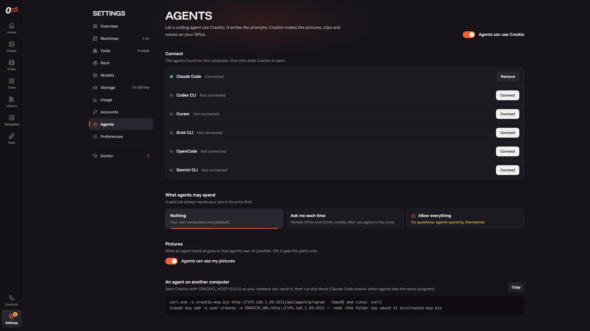

# Agents (MCP)

[← Back to Crackio](../README.md)

Crackio has an MCP server, so a coding agent can use it the way you use its screens. You say "make me a thumbnail"; the agent writes the prompts, makes drafts on your GPU, looks at them, and hands you the finished picture.

- **One click:** open **Settings → Agents**. Crackio lists the agents on your computer (Claude Code, Codex CLI, Cursor, Grok CLI, OpenCode, Gemini CLI, Antigravity CLI); **Connect** adds it to one, and shows the exact command first. **Remove** takes it out again.
- **22 tools:** make pictures and clips, use your Cast and LoRAs, retouch (close-up, whole picture or a redraw, with LoRAs), relight, re-angle, upscale, swap someone in a clip, shoot a product, open a place in the Director and move its camera (it sees each view), make a voice or a conversation, browse the Library, read your settings and install a tool (after you agree to its size).
- **Motion from your agent:** an agent can open a Motion project and work inside it with Motion's own tools: plan the piece, make its pictures and clips, build the animation in code, cut it with ffmpeg and look at its own render. Every step shows live on the Motion page, and the finished piece lands in your Library.
- **It knows your machines.** The agent sees each GPU and picks the size to match: drafts first, 1K when nothing is asked, 2K on a 24 GB card, and an upscale on smaller ones. Every answer says how its size was reached.
- **LoRAs explain themselves.** A LoRA's notes tell the agent how to prompt it, and a LoRA trained without captions says so.
- **The agent writes the prompt.** Crackio's prompt enhancer is never used for an agent: what it writes is what the model gets.
- **You decide what it may spend**, in Settings → Agents:
  - **Nothing** (the default): your own computers only.
  - **Ask me each time:** rented GPUs and Comfy credits, and every paid job needs your yes to its price.
  - **Allow everything:** no questions. It sits behind a warning, a tick and a double-click, and only you can switch it, on Crackio's own screen.
- **It asks before it spends time:** every tool can say the wait, the cost and the machine before it makes anything.
- **It's a guest:** agents share the queue with you, never cancel your jobs, and can delete only what an agent made.
- **The Director needs Chrome or Edge** on the computer Crackio runs on: Crackio opens a hidden page of the Director to draw the camera's view.
- **Not there yet:** Storyboard, Lip Sync and starting a training (an agent can use a LoRA you trained and read how its training went). Angles works by words only for an agent (the page's 3D view isn't used), so it's the weakest of the tools. Run for real (status read, a picture made on a GPU, the result seen) with Claude Code, Codex CLI, Gemini CLI, OpenCode and Antigravity CLI. Cursor and Grok CLI connect and list all 22 tools, but haven't been run through a job. A text-only model in your agent gets the file path without the preview picture.

By hand, for any MCP client: the program is `scripts/mcp/crackio-mcp.mjs` (plain Node, no packages), started as `node scripts/mcp/crackio-mcp.mjs`. It finds the Crackio that's running; set `CRACKIO_URL` when Crackio runs on another computer. Clients that connect to an address can use `http://localhost:3211/api/agent/mcp`.
