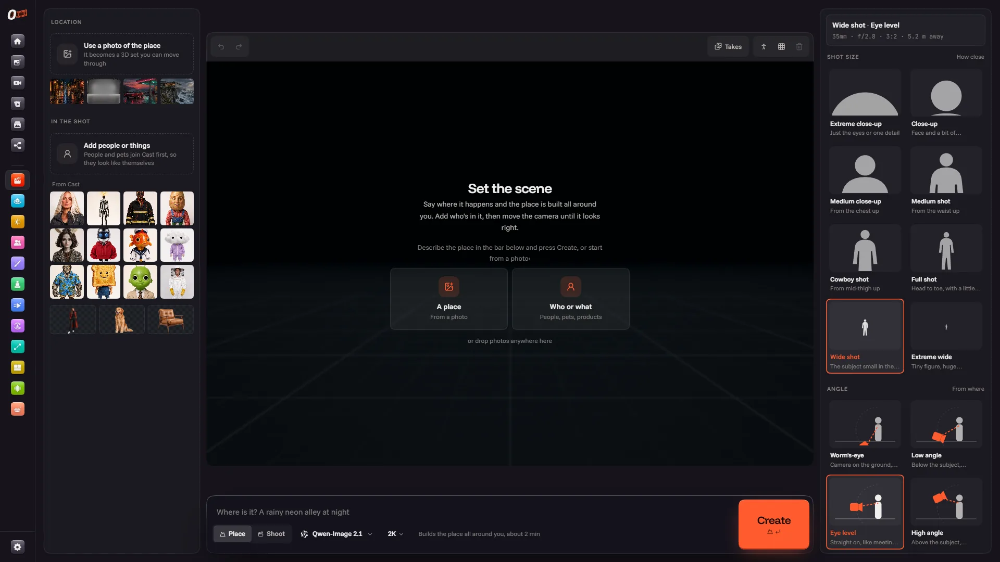

# Director

[← Back to Crackio](../README.md)

Stage a shot like a film set, then shoot it with open models on your own GPU.

- **A sentence or a photo becomes a 3D place.** Type "a sunlit Parisian café terrace, morning" (or drop a photo) and the place is built all around you. Walk through it with WASD (Q/E up and down, arrows to look). **Small extend** grows the place by half again, and **World around it** draws what lies beyond the photo.
- **Your cast and your products on their marks.** Add people, pets and things from **Cast** or straight from a photo (cut out on your machine), then move and turn each one on the set. **Arrange** places everyone from one sentence ("Kai rides the motorbike toward the camera, Noor waves"): sitting, riding, waving, pointing, a selfie with the arm held out.
- **A real camera.** Pick the lens, frame whoever is picked with one key, switch a rule-of-thirds grid on, and go back to the photo's own viewpoint whenever you get lost.
- **Shots drawn through a depth ControlNet**, so the picture keeps your camera and everyone's marks and looks like a film still, not a collage. Two open models:
  - **Z-Image Director** (Z-Image Turbo + Alibaba PAI's Fun ControlNet Union, Apache-2.0): the most cinematic. Measured: about 4 s a shot on an RTX 5090, 6.5 min on a GTX 1060 6 GB, 12 min on a MacBook Air M2 16 GB.
  - **Qwen Director** (Qwen-Image 2.1 + its Fun ControlNet, Qwen Research License, non-commercial): also takes your cast's and products' pictures, so faces and clothes stay theirs. About 14 s on an RTX 5090 (NVIDIA RTX 20 or newer, ~17 GB).
- **Takes keep their plan.** Every shot is filed with the set it was shot from, so you can compare, tweak and shoot again.
- **One screen, two views.** In **Set** you walk around the place and put people on their marks; looking around there never changes the shot. **Camera** is the shot itself, with its frame. Tab switches between them.
- **Film it** makes your last shot move. Pick a camera move or key the Camera on the timeline, and the clip follows it (LTX-2.5 on your GPU by default). **Save preview** plays the move through the Camera and saves it as a video with no AI, on any computer.
- **Fix this spot** changes one part of the place ("a stormy sky", "a red door"): what the Camera sees is cut out, changed by an image model and put back exactly where it was, so nothing else in the place changes.
- **Film a video again from a new camera.** Drop a video instead of a place, set a Camera path, and the Director films it again from there: MoGe-3 measures every frame in 3D and LTX-2.5 with Lightricks' Layout to Render IC-LoRA draws the finished shot. It needs an NVIDIA GPU with 24 GB or RunPod, and both LTX repos are gated on Hugging Face (accept their terms there first).
- **LoRAs** from the library switch on for the shot model in one click.
- Runs through ComfyUI on your own GPU, a second computer on your network, or a cloud GPU (RunPod serverless).

### How to use it

1. Open **Director** and say where it happens (or drop a photo), then press **Create**: the place is built around you.
2. Add who and what is in the shot, from **Cast**, a photo, or a product, and drag them onto their marks, or type one sentence into **Arrange**.
3. Press Tab for the **Camera** view and frame it: walk in with WASD and pick the lens.
4. Write what happens ("Lena waits outside the café with a coffee in her hand") and press **Shoot it**. Pick **Z-Image Director** for the most cinematic look or **Qwen Director** to keep faces exact.
5. Open **Takes** to compare each shot with your set, then move the camera or shoot again.
6. To make a shot move, set a camera move on the timeline and press **Film it**.
