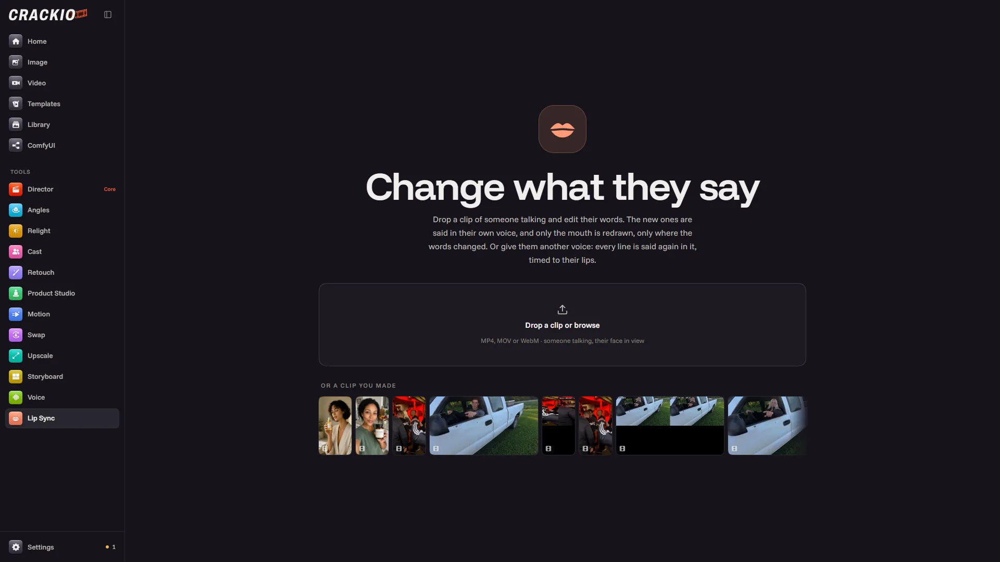

# Lip Sync

[← Back to Crackio](../README.md)

Lip Sync changes what someone in a clip says, and nothing else. Speech to text writes out the clip sentence by sentence, with times; you rewrite any sentence as text. For each stretch you changed, Crackio:

1. **Says the new words** in the speaker's own voice (cloned from the clip's own speech, only after you confirm you may use it) or in one of your voices, with Drama 3 or VoxCPM2. Three takes are made and heard back; the one that says every word and fits the time there wins (sped up by at most a fifth if nothing fits).
2. **Mixes them in:** the old words fade out over 20 ms and the new ones come in at the same moment; every other sound stays the clip's own.
3. **Redraws the mouth** with **LatentSync 1.6** on your GPU, from just before the new words to just after, and only round the mouth: MediaPipe finds the face (and any hand in front of it, which stays), LatentSync draws the lower face at 512 px, and only the area from under the nose round the jaw goes back, feathered, its skin colour and grain matched to the frame and the lips matched to their own colour. Each stretch is scored by SyncNet; a mouth that falls under 0.5 is drawn once more with another seed and the better one kept.
4. **Puts the video together** in the clip's own colours (BT.709, written in YUV without a round trip through RGB): the redrawn pixels go onto exactly their frames, everything is encoded once at CRF 10 with the clip's own colour tags, and every frame outside the changed stretches stays the clip's own (about 50.6 dB from the original after that one high-quality encode).

**Measured on an RTX 5090:** one changed sentence in a 10 s 1088×1920 clip took 95–117 s from Sync to done (the words about 15 s, the mouth about 60 s, the video about 15 s). SyncNet put the new mouth at 0.84–0.88 with the new words; the clip's own mouth with its own words scored 0.81–0.82. LatentSync needs about 11 GB of GPU memory (10.8 GB peaked with its check), so Lip Sync is offered on NVIDIA cards with 11 GB or more; it isn't tried on Macs yet.

**How to:** open **Tools → Lip Sync** → drop a clip of someone talking (or pick one you made) → click a sentence and rewrite it (Enter goes to the next; Ctrl or ⌘ Enter syncs) → keep **Their own voice** and tick that you may use it, or pick another voice → **Sync lips**. **Before / After** compare at the same moment; **Change more words** starts from the new take. The first time, the note at the top sets Lip Sync up on your GPU: its engine (pinned Python packages in their own folder, not ComfyUI's), MediaPipe's landmarkers and LatentSync's 7.1 GB of files (ByteDance's are gated: accept their terms on Hugging Face and add your token under Settings → Accounts), then a check with the model loaded.
