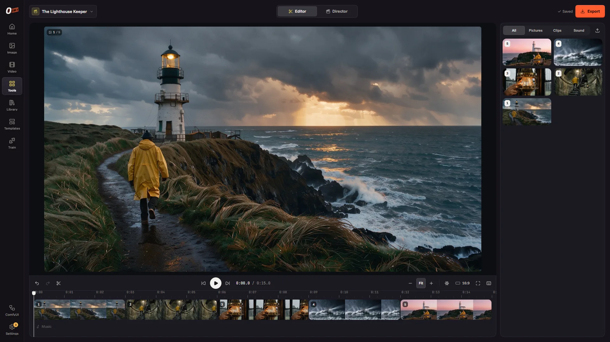

# Storyboard

[← Back to Crackio](../README.md)

Make a whole film, not one clip at a time: shoot your scenes in the Director, cut them together on a timeline, make each picture move, and export one MP4.

- **Every film is a project.** A project is a folder in your Library. Every shot and clip made inside it is filed there automatically, and the project keeps its timeline and its Director set (the place, the cast, the camera), so you can come back to it exactly as you left it.
- **The Director is built in.** Switch between **Editor** and **Director** at the top. In the Director you shoot from any angle in the same place with the same people, and each shot lands in the project's **Files**.
- **A simple timeline.** Shots follow each other with no gaps. Drag a shot to reorder it, drag its edges to trim it, press **S** to split. A music track sits under the shots. The bar above the timeline holds the selected shot's settings: length and push-in for stills; trim, speed and volume for clips; fill or fit and fades for both.
- **All to the film.** One click puts every shot from Files on the timeline in the order you made them. A **Next** button always shows the next step (shoot, cut, make shot 3 move, export) and does it.
- **Make it move.** Click a still and pick a camera move from 12 presets with preview clips (push in, orbit, crane up, dolly zoom, fly-through, POV…), a pace (slow, normal, dynamic) and a length. LTX-2.5 runs on your GPU or a cloud GPU, and the clip takes the still's place on the timeline. Your words can be refined by your own prompt writer, and you can @mention your Cast.
- **Export one MP4.** 720p or 1080p, in the film's shape (16:9, 9:16, 1:1, 4:5 or 21:9), with each clip's sound and your music mixed in. Everything is saved as you go.

### How to use it

1. Open **Storyboard**. Your film is a project: make a new one from the menu at the top left.
2. Switch to **Director**, build the place and add your cast, then shoot your scenes. Every shot lands in **Files**.
3. Back in **Editor**, press **All to the film** (or drag shots onto the timeline), then reorder and trim them until the story reads right.
4. Click a still, choose **Make it move**, pick a camera move and a pace, and press **Make the clip**. The clip takes the still's place when it's done.
5. Drop a sound on the music track if you like, then **Export** to get one MP4.
