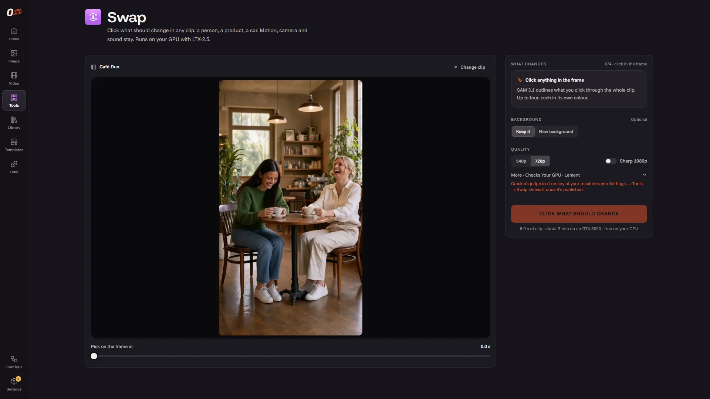

# Swap and Templates

[← Back to Crackio](../README.md)

### Swap

- **Click anything, pick what it becomes.** Drop a clip, click up to four things in it (people, products, cars) and turn each into someone from your Cast, a picture you add, a colour, anything you describe, or nothing at all (removed). A new background is optional, and the clip's own sound stays.
- **How it works, on your GPU:** SAM 3.1 follows what you clicked through the whole clip. FLUX 3 Klein redraws the frame where it shows best, with the pose read out in words first, and a vision model keeps the better of two takes (right character, whole outfit, same pose). Then **LTX-2.5** (22B, distilled) with WepeNerd's **Ripple** IC-LoRA carries that drawing through every frame, one pass each way for clips up to 20 s.
- **Long clips stay on model:** on clips over about 4 s the character is redrawn again every ~4 s on a calm frame, matched to the first drawing, and LTX gets those drawings as keyframes of the same pass, so nothing is blended or cut in. A keyframe that changed the wrong person, or the wrong pose, is thrown away.
- **Removals leave a clean plate:** removing something uses Lightricks' in/outpainting IC-LoRA on its tracked outline in every frame; the rest of the clip stays exactly as filmed.
- **Every drawing is checked** by Gemini 3.5 Flash (with a Comfy API key) or by Qwen3-VL 4B or 8B on your own GPU (4B is FLUX 3 Klein's own text encoder). One of the two is needed; you pick 4B or 8B on the Swap page.
- **Speed:** on an RTX 5090, a 6–8 s clip at 720p takes about 5 minutes from click to result; 15 s with two people about 13 minutes. It needs a GPU with about 24 GB (your own or a rented one). On small cards Crackio swaps characters with **SCAIL-2** instead: a 6 GB GTX 1060 makes 5 s in about 46 minutes.

**How to:** open **Tools → Swap** and drop a clip (or pick a preset) → click what to change and pick what each becomes → choose 540p or 720p (Sharp 1080p and Fast draft are optional) → **Swap**. The result plays next to the original.

### Templates

- **11 templates, all Crackio's own:** clips made on open models (FLUX 3 Klein stills, LTX-2.5 clips) with nobody's footage, likeness, music or brand in them, plus **Put Yourself in Any Clip** for a clip of your own.
- **You star in them:** add a photo or a Cast member for each role and Crackio writes the exact edit; each card plays a swap Crackio made on it.
- **Two-person templates:** click who becomes whom on the template's frame; each person is outlined in their own colour and followed and redrawn on their own.
- **Same engine as Swap:** templates run the Ripple swap on your own ComfyUI by default; with a Comfy key, Comfy Router's swap models are one click away.

**How to:** open **Templates** → pick a clip → add a photo or a Cast member for each role → click who becomes who (on two-person templates) → **Make it**.

## How Swap works (LTX-2.5 + Ripple)

Swap (Tools → Swap) and Templates swap on your own GPU with **LTX-2.5** and WepeNerd's **Ripple** IC-LoRA ("first frame, all frames"), both under the LTX-2 Community licence. Drop a clip and click up to four things in it, then pick what each becomes: someone from your Cast, a picture, a colour, anything you describe, or nothing (removed). A new background is optional. On a template with two people, you click who becomes whom.

1. **SAM 3.1 follows what you clicked** through the whole clip, forward and backward from the frame you clicked. It also finds every other person, and any ball, in every frame.
2. **One frame is redrawn**: the one where your subjects show best (the first frame, or 2 s in or later). Each subject is drawn by your picture model (FLUX 3 Klein, local), with its pose read out in words first. A vision model picks the better of two takes, checking identity, the whole outfit and the pose.
3. **Ripple carries that frame through the clip** both ways, each way in one pass (up to the longest clip, 20 s). On long clips your subjects are redrawn again about every 4 s, on a calm frame, matched to the first drawing, and LTX gets those drawings as keyframes of the same pass: the character stays as drawn, with nothing blended or cut in. The sound stays as filmed; "Keep everyone else exact" also puts the other people back from the clip.

On an RTX 5090, a 15 s clip at 720p takes about 5–6 min of GPU (about $0.15 on a RunPod serverless 5090).

## Character swaps on a 6 GB card (SCAIL-2)

Templates' character swap runs on your own GPU with **SCAIL-2** (Zhipu AI, MIT): the Wan 2.1 14B model that puts your character in place of a person in a clip and keeps the background, the camera and the moves. Its GGUF build (11 GB at Q4) streams from RAM, so an NVIDIA card with 4 GB free runs it next to 32 GB of RAM. Crackio makes a small card's work count:

- **Only the people are made.** SAM 3.1 tracks the people being replaced through the clip once; SCAIL-2 makes just the box around them, at the clip's own sharpness, and every frame goes back onto the original. The background and everyone else stay exactly as filmed.
- **Posed first.** SCAIL-2 keeps the pose of the picture it's given: from a front-facing Cast picture, a man in profile at a keyboard became a scarecrow facing the camera beside it. So your picture model first draws each character in the place, size and pose of the person it replaces, from the clip's first frame, and SCAIL-2 animates that drawing: the scarecrow then stands where the man stood and plays the keys.
- **Windowed attention.** After the first step each frame attends only to its neighbours, the reference and its pose (`Crackio Window Attention`, in the bridge): on a GTX 1060 a step of a 5 s clip takes 12 minutes instead of 19.
- **fp16 on cards without bf16** (`Crackio FP16 On Old GPUs`): half the memory for every activation, at the same speed.
- **Every 2nd frame on a slow GPU.** When a 5 s segment would take more than 10 minutes, SCAIL-2 makes every 2nd frame in 4 steps and FILM (ComfyUI's own Frame Interpolate) draws the frames between, in under half a minute. Faster cards keep every frame and 6 steps.

On a GTX 1060 6 GB (2016) with 48 GB of RAM, one person replaced at the clip's own 720p detail took about 46 minutes for 5 seconds: possible on a card most AI tools don't list, but slow. Every step above cuts work on any GPU, not only old ones; a mid-range RTX card should take minutes (an estimate; SCAIL-2 at 704p, before these changes, took about 5 minutes per 5 s on an RTX 5090).
