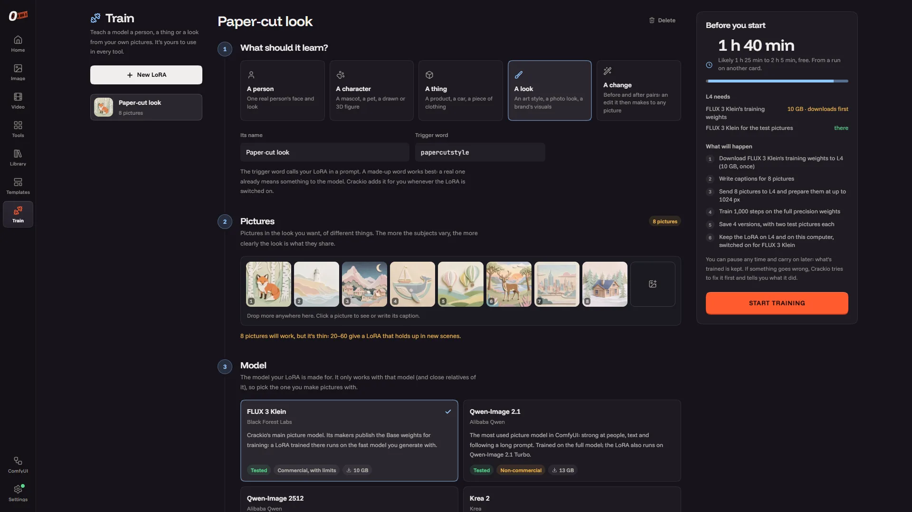

# Train

[← Back to Crackio](../README.md)

Teach a picture model something of your own: one person, a character, a product, a look, or a change. Drop in 10 to 200 pictures and Crackio trains a LoRA on your GPU, then switches it on for the model, so the next picture you make already has it.

- **Nothing else to install:** the training runs inside the same ComfyUI your pictures do, through Crackio's helper, on this computer, a rented GPU or a computer on your network.
- **Crackio sets it up:** steps, picture size and the rest are picked from your set, the model and the machine, and each one says what it does and why it has that value. Change any of them and it stays yours.
- **You see what it will take before it starts:** each machine shows whether the model fits, how long the run takes there, what it costs and what it still has to download: the training weights and the picture model for the test pictures, with a link to pick another. The picture model is set up before training starts, so a run never waits for it halfway.
- **Captions are written for you** by a small vision model on the GPU, and each caption keeps the name of the model that wrote it. A run never trains without captions in silence: when none can be written it stops and asks.
- **You watch it learn:** a version is saved several times along the way, each with the same two test pictures next to the model without your LoRA. The best version is often not the last one; pick it when the run is done. Every version is copied to your computer as it's saved, so you can still pick after the machine it trained on is off, or a rented one is deleted.
- **It looks after itself:** a ComfyUI that isn't running is started, an old helper is updated, a run out of GPU memory carries on with part of the model in RAM or at a smaller picture size, and a restarted machine picks up where it stopped. What Crackio did is listed, and the full log is one tab away.
- **A rented GPU isn't left idle or cut off:** runs take a machine one after another in the order you start them, the next one downloads its model while the one before it trains, and when the account's credit is about to run out the run is paused first, with what's trained brought to your computer.
- **It learns edits too:** pick **A change**, drop the pictures as they are on **Before** and the same pictures with the change made on **After** (the same file names pair up), and say the change the way you'd ask for it. The LoRA then makes that change to any picture you give the model. A before picture you leave without its after picture is what the test pictures redo, so you see the change on a picture the LoRA never learned from.
- **Your own model files work too:** put a fine-tune's .safetensors in the machine's `models/diffusion_models` (or `models/checkpoints`) and it shows up, with what it is and whether the machine can train it.

**Models you can train**, each with its licence on its card (a LoRA carries its model's licence):

| Model | Licence | Learns | Trained end to end by Crackio |
|---|---|---|---|
| FLUX 3 Klein | FLUX Kommunity (commercial under $5M a year) | pictures, edits | Yes: 1.5 s a step at 1024 px in 16 GB on an RTX 4090 (INT8: 1.2 s in 9 GB); an edit LoRA at 3.2 s a step in 15 GB on an RTX 3090 |
| Qwen-Image 2.1 | Qwen Research (non-commercial) | pictures, edits | Yes: 4.1 s a step at 1024 px in 18 GB on an RTX 3090 (INT8: 3.1 s in 12 GB; streamed from RAM at 768 px: 3.6 s in 5 GB); an edit LoRA at 4.6 s a step in 18 GB |
| Qwen-Image 2512 | Apache-2.0 | pictures | Yes (short run): a 20B model, streamed from RAM on a 24 GB RTX 3090 at 6.7 s a step in 8 GB |
| Krea 2 | Krea 2 Community (commercial under US$1M a year) | pictures | Yes: 4.6 s a step at 1024 px in 18 GB on an RTX 3090 (INT8) |
| Z-Image | Apache-2.0 | pictures | Yes (short run): 3.7 s a step in 17 GB on an RTX 3090 |
| FLUX.2 klein 4B | Apache-2.0 | pictures | Yes (short run): 2.4 s a step in 11 GB on an RTX 3090 |
| SDXL | OpenRAIL++-M | pictures | Yes (short run): 1.3 s a step in 8 GB on an RTX 3090 |

Qwen-Image-Edit 2511 is set up but held back: on a 24 GB card it doesn't train through yet (its INT8 weights take ComfyUI down when streamed from RAM, its FP8 weights give no usable gradients), and it hasn't been tried on a card that holds it whole.

A LoRA is trained on the model's full (undistilled) weights and runs on its fast version too. On a 12 to 16 GB card FLUX 3 Klein trains on its INT8 weights (2.6 s a step in 9 GB on an RTX A4500), and that LoRA loads on both the INT8 and the full-precision picture model. Models differ in how they take a look: the same 20 pictures left FLUX 3 Klein's and Krea 2's close-ups photographic, where Qwen-Image 2.1 drew everything in the look from step 800 (after a stretch around step 600 where its faces broke: the versions saved along the way show when it has settled) and Qwen-Image 2512 had both test pictures in it after 300. Training runs on NVIDIA GPUs (your own on Windows or Linux, or a rented one); a Mac can't train on its own GPU yet, but trains on a rented one from the same page. Not run by Crackio yet: FLUX 3 Klein on a Windows PC's own card of 12 GB or more (Windows was tried with Stable Diffusion 1.5 on a 6 GB card), AMD and Intel GPUs, and training on RunPod Serverless. Video LoRAs aren't part of it yet.

**A run isn't tied to its machine.** Pause it and press **Move to another machine**: what's trained so far comes to your computer, goes to the GPU you pick, and training carries on at the same step. Pausing on a rented GPU keeps that copy by itself, so a box that won't start again doesn't take the run with it.

**How to:** open **Train** → **New LoRA** → say what it is and name it → drop your pictures → pick the model and the machine → **Start training**. When it's done: **Make a picture with it**, and write a line under **How to prompt it** (the words that work, the strength): the note stays with the LoRA, for you and for an agent. For a change: **A change** → name it and say the change → drop the before and the after pictures → the rest is the same.

**Got a LoRA already?** In any model's **LoRAs** page, press **Upload a LoRA** (or drop the `.safetensors` file there). Crackio keeps the file on your computer, checks it from its header (a real LoRA, named in a way the model's loader reads, its layers that model's: a file made for another model gets a warning), and sends it to whichever GPU a job runs on, a box you rented a minute ago included. Name it, give it its trigger words once (Crackio adds them to every prompt), switch it on or off per model.
