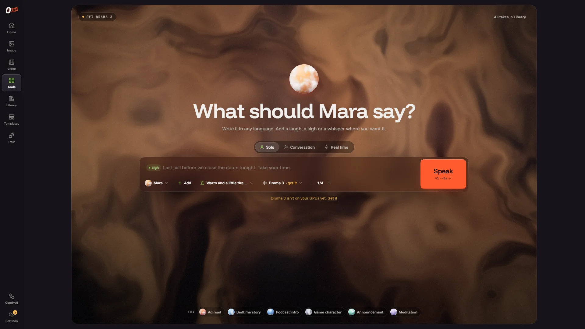

# Voice

[← Back to Crackio](../README.md)

Voice turns a script into speech on your own GPU. The default is **Fish Audio Drama 3**, the best-rated open voice model on the Artificial Analysis speech arena: it follows directions written in plain words, adds [laughs], [sighs] and pauses where you put them, whispers or slows down chosen words, and plays scenes with several voices in one take, in about 80 languages. Built with Fish Audio.

### How to use it

1. Open **Voice**. Type what should be said in the bar, as on Home (Enter speaks, Shift+Enter starts a new line). **Add** puts a laugh, a chuckle, a sigh, a gasp, a breath or a pause where the cursor is, or makes the selected words whispered, slower or stressed; every one has a ▶ to hear it first.
2. Pick who says it: one of Crackio's 12 voices (each designed from words with VoxCPM2, not copied from anyone), or **Clone a voice** from 10–30 seconds of you talking (record it or upload a clip; Crackio types out what it says and asks you to confirm the voice is yours or that its owner agreed), or **Design a voice** from a description and keep one of three takes.
3. Optionally say how it's said ("warm and a little tired"), or pick a mood (calm, warm, excited, serious, sad, storyteller, playful, announcer; each with a take to hear), steady to lively, and the language. The **+** next to the voice makes it a conversation for up to four voices, one line each.
4. Press **Speak**. Each take plays with its words lighting up as they're said; **Again, but…** makes another go with a note ("happier", "slower"). Takes land in the Library like everything else, with the ComfyUI graph that made them.

The first time, the model picker (the same model library as everywhere in Crackio, with a sample to play on each card) gets the model onto your GPU: Drama 3 (17–25 GB, by your card; on 16 GB cards part of it stays in RAM), VoxCPM2 (3 GB, 8 GB cards and Macs) or Supertonic 3 (0.3 GB, any computer), plus Qwen3-ASR and its aligner for transcripts and word timings. They run in the Crackio bridge's **Crackio Voice** node through [audio.cpp](https://github.com/0xShug0/audio.cpp), a C++ engine for open speech models, so no Python packages are added to ComfyUI. Drama 3 is under the Fish Audio Community License: free for personal use and for businesses under $500k a year, and not for hosted services, so the online demo doesn't offer it.
